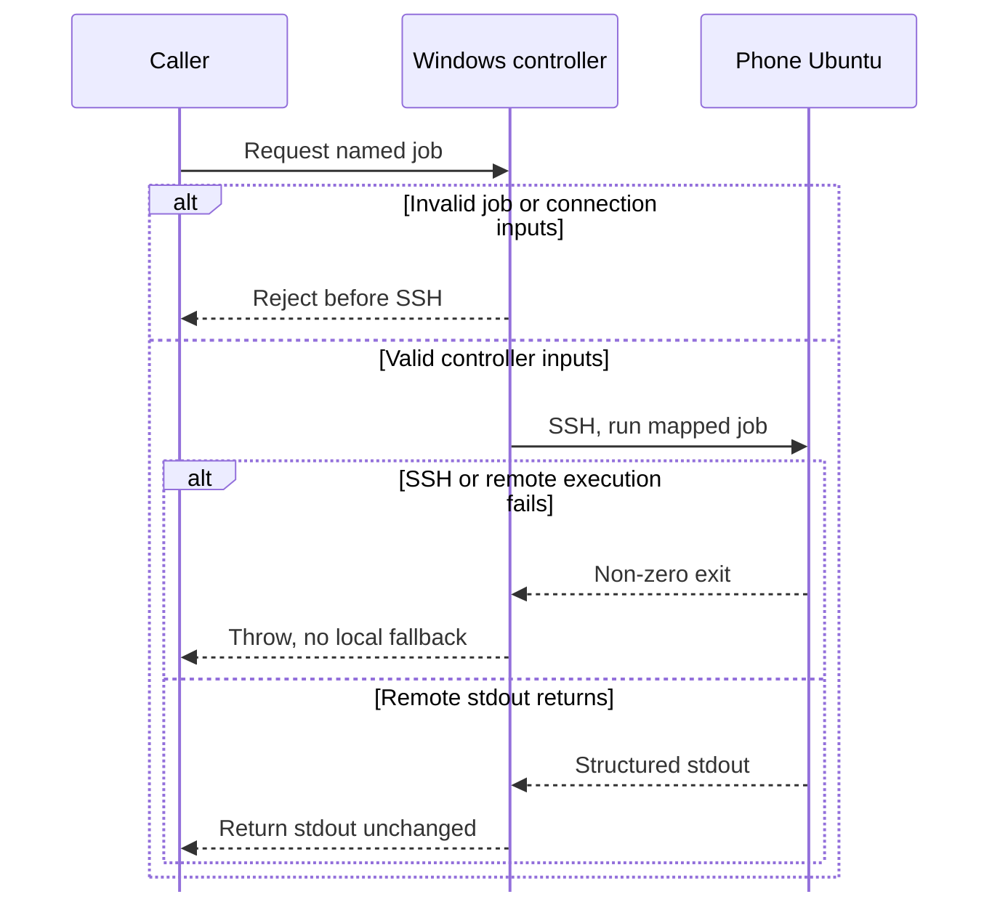

# Ubuntu Phone Compute Bridge

My Windows machine is not exactly a workstation built for heavy compute. I experimented with having a phone-hosted Ubuntu environment run named jobs instead.

But there was one rule I cared about: **if the phone didn't do the work, don't tell me the phone did the work.** A local fallback disguised as remote success would make the whole experiment pointless.

## What travels between the machines

The Windows [PowerShell controller](windows/Invoke-SafeUbuntuJob.ps1) accepts reviewed job names, makes an SSH request with explicit host/user/port/key and host-key checking, and returns remote stdout. It doesn't substitute a local result if SSH fails.

The caller then validates that stdout separately:

- It's valid JSON and within the size limit.
- It names the **expected job**.
- `execution_location` says `phone-ubuntu`.
- `ok` really is `true`.
- If an artifact digest is supplied, its SHA-256 matches the bytes.

An honest failure is better than a forged victory. Especially when the forged victory was calculated by the laptop that couldn't handle the job in the first place.

## When the phone doesn't answer

The controller never quietly pretends the local computer did a remote job.

The returned stdout is *not* a success certificate. The caller separately checks JSON size, job identity, execution location, success state, and the expected artifact digest. All of those checks are documented above; another two-box diagram would add nothing.

The [tests and setup notes](docs/verification.md) cover failed SSH, wrong job identities, and digest mismatches. Read the [job registry](src/compute_bridge/jobs.py), [result parser](src/compute_bridge/results.py), [hash verification](src/compute_bridge/integrity.py), and [job contract](docs/job-contract.md).

This repo **doesn't include** a reachable phone, live worker, keys, IP addresses, or evidence that a current device is online. It's the controller/result contract and tests. [Verification](docs/verification.md) · [security](SECURITY.md).
